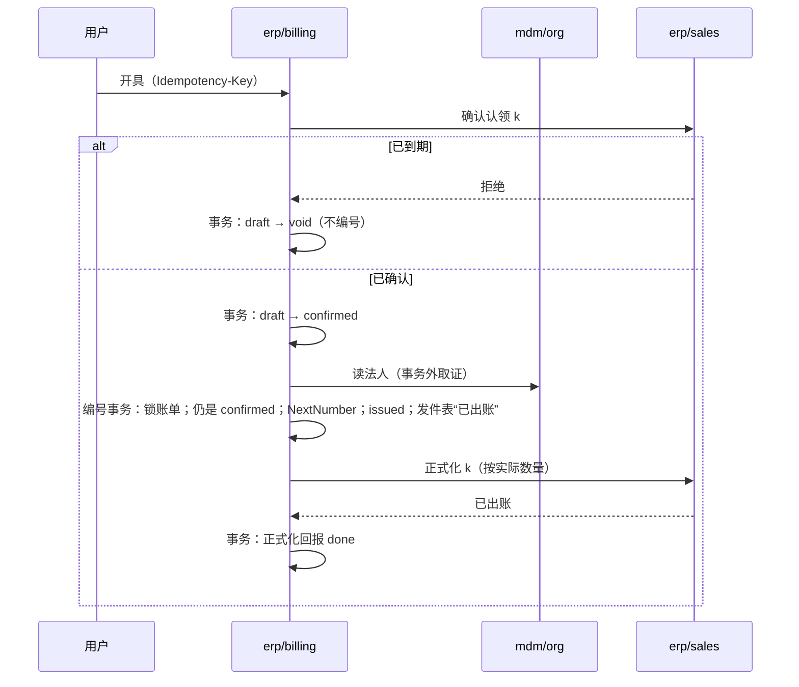

# 出账的顺序

从订单草拟到正式化，每一步做什么、调谁、失败或结果未知时怎样。认领的守卫与状态在协议 05 的认领模式，账单本地的状态在 [design.md](../design.md#账单的状态)；测试按协议 05 的 BL 编号命名。

## 草拟

| 步骤 | 做什么 | 失败时 |
| --- | --- | --- |
| 1 | 幂等认领（`Idempotency-Key`） | 同键同请求返回原账单 |
| 2 | 读订单（销售的系统读取）与可出账台账；行与数量缺省为每行剩余（`billable − claimed − billed`，两维） | 没有剩余：拒绝 |
| 3 | 向销售认领（认领身份 = 新的账单身份） | 拒绝：不建账单，回答原因（BL01）；未知：用同一身份重试（BL02），仍未知则答“依赖不可用”，留给认领的到期回收 |
| 4 | 事务：建账单 `draft`，明细与快照 | — |

第 3 步成功、第 4 步之前崩溃：来源留着一条 `pending` 认领，没有账单；认领到期后由来源回收（7 天）。用户用同一 `Idempotency-Key` 重试时，用同一账单身份再认领，来源返回原认领，接着建账单。

## 开具

| 步骤 | 失败或结果未知 |
| --- | --- |
| 确认认领 | 未知：用同一身份重试（BL24）；拒绝：账单作废（BL05、BL26） |
| 法人取证 | 法人不是 `active`：停在 `confirmed`，回答原因；用户可以作废（释放认领）或等法人恢复后再开具 |
| 编号事务 | 账单已被作废：编号失败，回答“已作废”（BL25） |
| 正式化 | 未知或失败：编号事务里已排入恢复工作项（协议 01），重发直到来源确认（BL04）；用户看到的账单已是正式的 |

## 作废

| 状态 | 做什么 |
| --- | --- |
| `draft` | 事务：`void`；之后向来源释放认领（失败由工作项重发；释放是幂等的） |
| `confirmed` | 同上；先本地作废，再释放，不能反过来（BL25） |
| `issued` | 拒绝：正式账单只能更正（以后） |

## 恢复工作项

| 工作项 | 何时排入 | 做什么 |
| --- | --- | --- |
| 正式化 | 编号事务里 | 向来源正式化，直到确认；然后正式化回报 `done` |
| 释放 | 作废的事务里 | 向来源释放，直到成功 |
| 继续开具 | 确认认领后的事务里（延迟一分钟） | 发现仍是 `confirmed`（开具中途崩溃）：重新取证、编号；仍不行就告警 |
